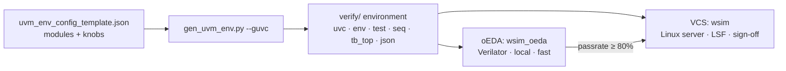
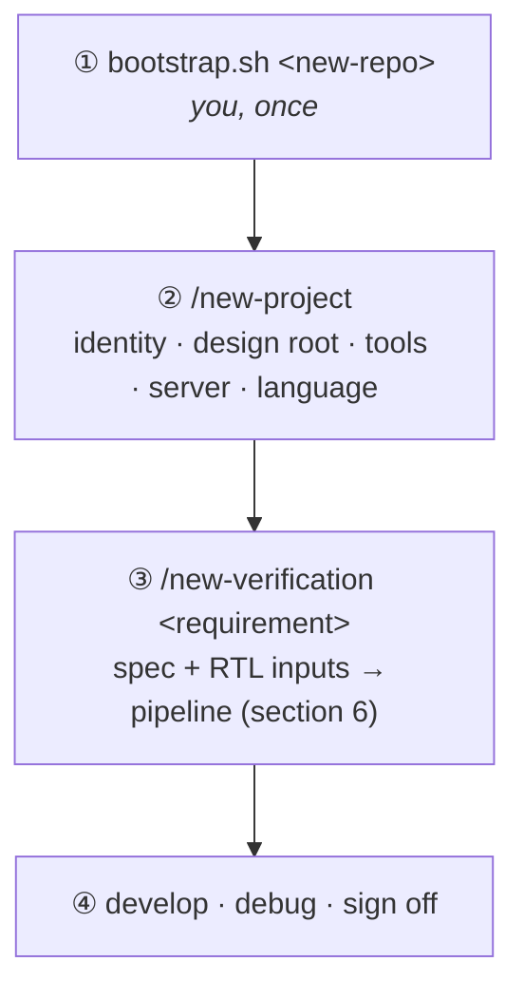
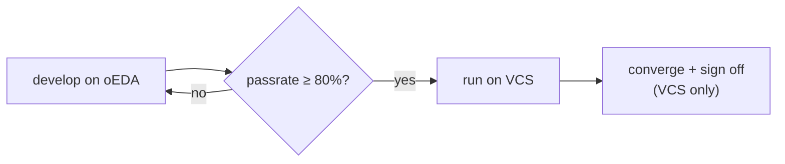
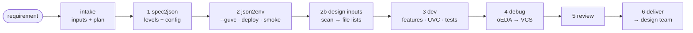
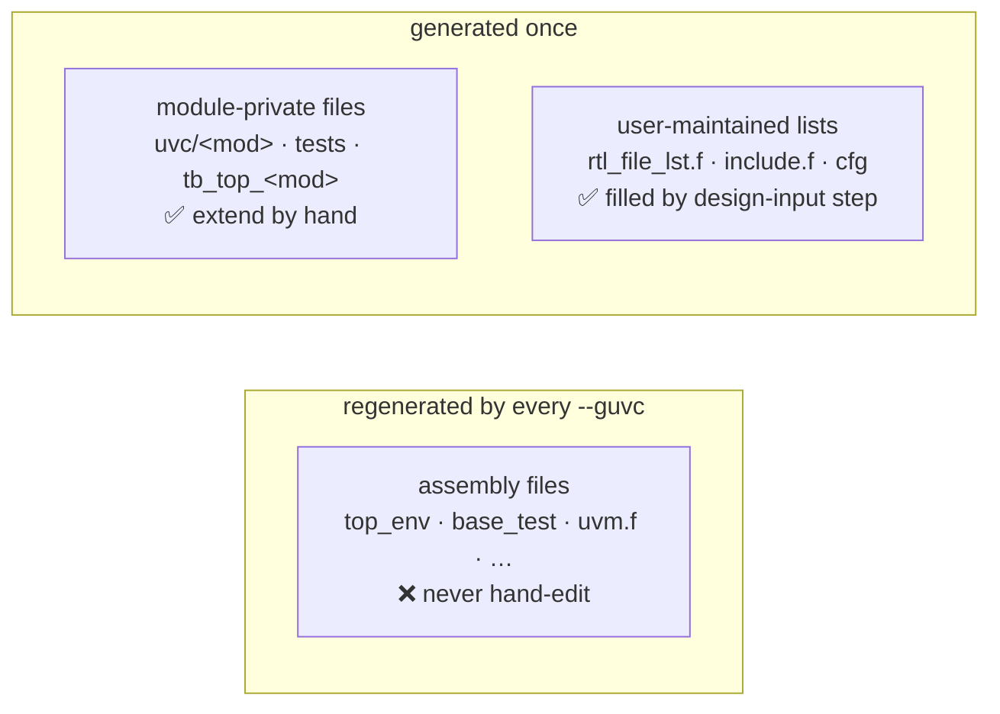

# Verification Framework — Quick Start

A UVM-1.2 verification environment for one chip, **generated from a JSON config** and then extended by hand, with two simulation flows and a **multi-agent flow on Claude Code** that drives the work with you confirming every decision.



This page is the map. The rules themselves live in `CLAUDE.md` (commands, generation, conventions) and `docs/ops/multi_agent_ops.md` (process); every section below points there.

---

## 1. Prerequisites

| What | Needed for |
|---|---|
| Linux server with VCS, Verdi, LSF (`bsub`) | VCS flow, sign-off, coverage closure |
| Verilator (OSS CAD Suite) + UVM-1.2 (`$UVM_HOME`) | oEDA flow (local bring-up and debug) |
| Python 3.6+ with `openpyxl` | generators, RAL model generation, `new_project.py` |
| Claude Code, **started from `verify/`** | multi-agent flow (hooks, agents, skills live in `verify/.claude/`) |

## 2. Layout

```
<repo>/
├── verify/                  ← this tree; start Claude Code here
│   ├── script/              ← SOURCE OF TRUTH: generators, flow scripts, new_project/
│   ├── uvc/<mod>/           ← one UVC per module (generated once, then hand-extended)
│   ├── env/ test/ seq/      ← top env, base + leaf tests/sequences
│   ├── tb_top/              ← tb tops, filelists, macros, configs
│   ├── json/                ← test-case definitions (json/case/<mod>.json)
│   ├── docs/                ← ops runbook, memories, features, reports
│   └── .claude/             ← agents, skills, rules, hooks
├── sim/                     ← deployed wsim / wsim_oeda + scratch runs
├── deliver_bridge/          ← exchange with the design team
└── <design-root>/           ← RTL, IP, netlists, register table (chosen in /new-project)
```

## 3. Quick start A — a new chip project



```bash
# ① copy the framework into a new repo (chip-specific state is left behind)
bash verify/script/new_project/bootstrap.sh <new-repo>
cd <new-repo>/verify && claude                              # start Claude Code here

# ② and ③ inside Claude Code
/new-project
/new-verification <what to verify>
```

Every value is **proposed from what the tools detect, then confirmed by you** — nothing is written before you approve the summary. Answers are recorded in `script/new_project/answers.json`.

**Later framework updates** — in the project, run `/new-project sync <framework-repo>`: each carried file is compared three ways (the framework version the project last took, the framework's latest commit, the project's file) with the project's own values applied first. Untouched files take the update, edits on both sides are merged, a real conflict leaves the framework version in `<file>.fw-new` for you to resolve, and every file the framework deleted is confirmed one by one. Generated files and chip state are never touched.

## 4. Quick start B — run a case

```bash
bash verify/script/file_manage.sh          # deploy flow scripts into sim/ (after any change in script/)
cd <repo>/sim
```

| Goal | oEDA (local, Verilator) | VCS (Linux server) |
|---|---|---|
| one case | `./wsim_oeda -c <case>` | `./wsim -c <case>` |
| fixed seed | `./wsim_oeda -c <case> -seed 1` | `./wsim -c <case> -seed 1` |
| waveform | FST by default (`-nowave` to skip) | `-fsdb` |
| coverage | `-covrpt` (line/toggle) | `-cm` (code), `-fm` (functional) |
| regression | — (loop over cases) | `-m <mod>`, `-smoke`, `-stage1`, `-stage2`, `-full` |

**Pass** = simulator exit 0 and no `UVM_ERROR` / `UVM_FATAL` in `sim.log`. Results: `result.txt` (VCS: `sim/`; oEDA: `sim/uvm_scratch_oeda_<case>/`), rerun commands for VCS failures in `sim/fail_wave.txt`.



An oEDA pass is **necessary, never sufficient**: functional coverage, SVA and gate-level runs exist only on VCS. Full option list: `./wsim -h`, `CLAUDE.md` → Commands.

## 5. Quick start C — daily work

| Task | How |
|---|---|
| Add a test case | ask Claude to add one (add-test-case skill: test + sequence + JSON entry), then fill `body()` — guide: `.claude/skills/add-test-case/test_case_dev_manual.md` |
| Define a test | `json/case/<mod>.json` entry: regression flags, `UVM_TESTNAME`, `VCS_MACRO_OPT`, `VCS_PLUSARGS_OPT` — never edit generated list files |
| Compare the two flows | `/conv-report` |
| Add / remove a module | via `/new-verification` (spec2json → json2env) — never by hand |
| New design files arrived | rerun `/new-verification` → design-input step shows what changed |

## 6. The multi-agent flow

The main Claude session is the **leader**: it plans, dispatches the agents and asks you; it does not write code. Each agent handles one stage (one dev/debug instance per module).



**You decide at these points** (the leader asks; nothing proceeds without your answer):

| ✋ Checkpoint | What you confirm |
|---|---|
| intake | which stages run; spec location (doc mode) or none (pre-research on RTL) |
| after spec2json | module partition, config, register-table location |
| design inputs | RTL / include / IP / macro lists proposed from a scan of the design root |
| feature list | the module's feature points before development starts |
| reference model | the plan before any model code is written |
| RTL access | in doc mode, an agent may read RTL only for spec ambiguity / suspected issue / gray-box checks — per task, with your approval |
| commit | every commit (agents never commit) |

Hooks enforce the hard rails: agents write only under `verify/`, `deliver_bridge/`, `sim/`; source-of-truth edits by agents need your approval; agents cannot commit; doc-mode RTL reads need a grant. Process details: `docs/ops/multi_agent_ops.md`.

## 7. Commands and skills

| Command | Purpose |
|---|---|
| `/new-project` | set the project-level values after a bootstrap |
| `/new-project sync <framework-repo>` | pull a newer framework version into this project |
| `/new-verification <req>` | start a verification effort (intake → pipeline) |
| add-test-case *(ask Claude)* | scaffold test + sequence + JSON entry |
| `/conv-report` | oEDA vs VCS convergence report |
| `/doctor prompt-audit [docs/]` | check instruction files / docs for stale or conflicting text |
| `python script/new_project/new_project.py status` | which project values are set, deferred, pending |
| `python .claude/hooks/rtl_access.py mode` | current RTL-access mode and design root |

## 8. Rules of thumb



1. **Edit `script/`, then deploy** — `sim/wsim*`, `tb_top/scripts/` and `utils/` are copies.
2. **Never hand-edit assembly files** — change the template in `script/gen_uvm_env.py` and regenerate.
3. **Commit before regenerating**; after it, check `git diff` + one smoke run (`./wsim_oeda -c <mod>_smoke_block_test`).
4. **Project-wide settings live only in `script/sflow/flow_env.sh`**; machine-specific ones (`UVM_HOME`, tool paths) stay environment variables.
5. **oEDA code must also compile on Verilator** — no `program` blocks, SVA only in `*_if_pc.sv` under `` `ifndef OPEN_EDA `` (rules load automatically when you open `.sv` files).
6. **Spec defines expected behaviour** — RTL never becomes the reference model.

## 9. Where to look next

| Question | Look at |
|---|---|
| Which document holds what | `docs/ops/multi_agent_ops.md` §4 (doc map) |
| Commands, generation, conventions | `CLAUDE.md` |
| Current modules, open gaps, project rules | `docs/memory/arch_memory.md` (§0, §9, R1–R7) |
| A module's DUT facts and quirks | `docs/modules/<mod>.md` |
| Campaign reports | `docs/reports/` |

## 10. Troubleshooting

| Symptom | Fix |
|---|---|
| A path argument turns into `C:/…/Git/…` on Windows | prefix the command with `MSYS_NO_PATHCONV=1` (Git Bash path conversion) |
| `register table not found` | set it in `/new-verification` (register-table step); RAL cases need it |
| `[path_guard] BLOCKED … design database` | doc mode: the agent must file an RTL ACCESS REQUEST; the leader asks you |
| `[path_guard] BLOCKED … permission mode 'auto'` | switch to default mode (Shift+Tab) to approve source-of-truth edits, then re-dispatch |
| oEDA compile fails after a regeneration | check `git diff` on assembly files; template escapes (`\\n`) in `gen_uvm_env.py` |
| Edited a hook | run `python .claude/hooks/test_path_guard.py` before committing |
| `<file>.fw-new` after a sync | a framework change collided with a local edit: compare (`git diff --no-index <file> <file>.fw-new`), merge by hand, delete the `.fw-new` |
| Project bootstrapped before sync existed | ask Claude to follow the *Sync mode* section of `<framework-repo>/verify/.claude/skills/new-project/SKILL.md` (the project's own copy has none until the first sync) |
| `bootstrap: the framework audit failed` | in the source repo run `python script/new_project/new_project.py audit` and fix each FAIL (classify the file in `manifest.txt`, reword a module name, add a doc-map row, register the value in `vars.json`) |
