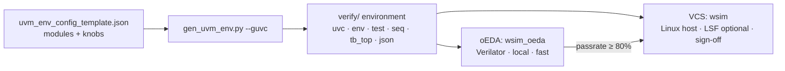
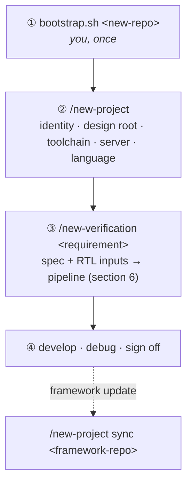
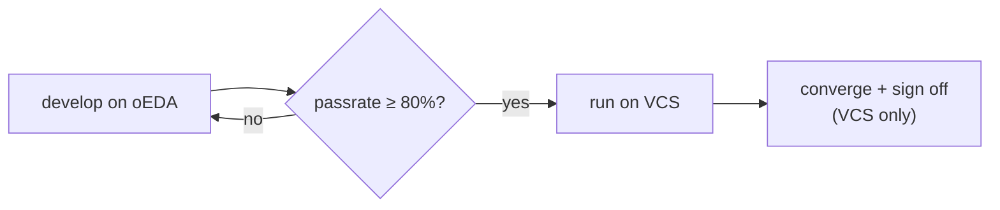
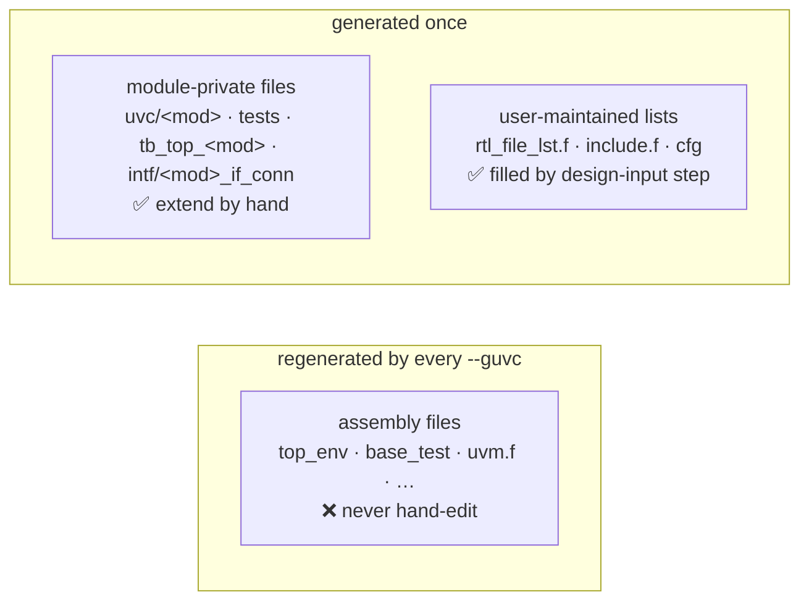

# Verification Framework — Quick Start

A UVM-1.2 verification environment for one chip, **generated from a JSON config** and then extended by hand, with two simulation flows and a **multi-agent flow on Claude Code** that drives the work with you confirming every decision.



This page is the map. The rules themselves live in `CLAUDE.md` (commands, generation, conventions) and `docs/ops/multi_agent_ops.md` (process); every section below points there.

**Framework repo vs. project.** The framework repository carries no chip: its config lists no modules and nothing generated is committed. A chip project is bootstrapped from it, gets its modules through `/new-verification`, and pulls later framework versions with `/new-project sync`.

---

## 1. Prerequisites (Linux)

| What | Needed for |
|---|---|
| Linux host with VCS and Verdi; LSF (`bsub`) optional | VCS flow, sign-off, coverage closure |
| **Verilator ≥ 5.054** (OSS CAD Suite) + **Accellera UVM-1.2** (`$UVM_HOME`) — recommended | oEDA flow (local bring-up and debug) |
| Python 3.6+ with `openpyxl` | generators, RAL model generation, `new_project.py` |
| bash | `wsim`, `wsim_oeda`, `file_manage.sh` |
| Claude Code, **started from `verify/`** | multi-agent flow (hooks, agents, skills live in `verify/.claude/`) |

- Older Verilator releases or a simulator-bundled UVM still run, with known incompatibilities: `/new-project` (P2) and `new_project.py check --stage project` report what this machine has, and `wsim_oeda` warns on every run. Setup and the reasons: `docs/ops/oeda_local_setup.md`.
- **csh/tcsh users:** the flow scripts are bash and do not see variables set only in `~/.cshrc` — export `UVM_HOME` and source the OSS CAD Suite `environment` where bash sees them (`~/.bashrc` / `~/.profile`).

## 2. Layout

```
<repo>/
├── verify/                  ← this tree; start Claude Code here
│   ├── script/              ← SOURCE OF TRUTH: generators, flow scripts, new_project/
│   ├── uvc/<mod>/           ← one UVC per module (generated once, then hand-extended)   ┐
│   ├── env/ test/ seq/      ← top env, base + leaf tests/sequences                      │ in a project,
│   ├── intf/                ← DUT ↔ interface signal connection per module              │ after the first
│   ├── tb_top/              ← tb tops, filelists, macros, configs                       │ --guvc
│   ├── json/                ← test-case definitions (json/case/<mod>.json)              ┘
│   ├── docs/                ← ops runbook, memories, features, reports
│   └── .claude/             ← agents, skills, rules, hooks
├── sim/                     ← deployed wsim / wsim_oeda + scratch runs
├── deliver_bridge/          ← exchange with the design team
└── <design-root>/           ← RTL, IP, netlists, register table (chosen in /new-project)
```

## 3. Quick start A — a new chip project



```bash
# ① copy the framework into a new repo (chip-specific state is left behind)
bash verify/script/new_project/bootstrap.sh <new-repo>
cd <new-repo> && git init && cd verify && claude          # start Claude Code here

# ② and ③ inside Claude Code
/new-project
/new-verification <what to verify>
```

- Every value is **proposed from what the tools detect, then confirmed by you** — nothing is written before you approve the summary. Answers are recorded in `script/new_project/answers.json` (commit it).
- `project_name` is also the project id (`` `define PID <name> `` in `script/sflow/project_name`, compiled by both flows).
- P2 checks the toolchain against the recommended versions; P3 sets the server values in `script/sflow/flow_env.sh` (LSF, python, DPO, and `agent_vcs_max_jobs`, the agents' concurrent VCS runs, default 3).

**Later framework updates** — in the project, run `/new-project sync <framework-repo>`: each carried file is compared three ways (the framework version the project last took, the framework's latest commit, the project's file) with the project's own values applied first. Untouched files take the update, edits on both sides are merged, a real conflict leaves the framework version in `<file>.fw-new` for you to resolve, and every file the framework deleted is confirmed one by one. Generated files and chip state are never touched — after a sync that changed the generators or flow scripts, redeploy (`bash script/file_manage.sh`) and let json2env rerun `--guvc`; module-private files (block tops, `if_conn`, monitors) keep their old form and are updated by hand.

## 4. Quick start B — run a case

```bash
bash verify/script/file_manage.sh          # deploy flow scripts into sim/ (after any change in script/ or a sync)
cd <repo>/sim
```

| Goal | oEDA (local, Verilator) | VCS (Linux host) |
|---|---|---|
| one case | `./wsim_oeda -c <case>` | `./wsim -c <case>` |
| fixed seed | `./wsim_oeda -c <case> -seed 1` | `./wsim -c <case> -seed 1` |
| waveform | FST by default for `-c`, off for regressions (`-wave` / `-nowave`) | `-fsdb` |
| coverage | `-covrpt` (line/toggle; merged for a regression) | `-cm` (code), `-fm` (functional) |
| regression | `-m <mod>`, `-smoke`, `-stage1`, `-stage2`, `-full` (`-j N` parallel runs, default 2) | `-m <mod>`, `-smoke`, `-stage1`, `-stage2`, `-full` |
| guard a license wait | — | `-timeout <seconds>` |

**Pass** = simulator exit 0 and no `UVM_ERROR` / `UVM_FATAL` in `sim.log`. Results: VCS `sim/result.txt` + rerun commands in `sim/fail_wave.txt`; oEDA per case `sim/uvm_scratch_oeda_<case>/result.txt`, for a regression also `sim/oeda_result.txt` (pass rate) + `sim/oeda_fail_rerun.txt`.

- A **block-level case** carries `+<MOD>_BLOCK_TEST` in its `VCS_MACRO_OPT` (any position); both flows then compile `tb_top/filelist/uvm_blk_<mod>.f` with the top `tb_top_<mod>.sv`.
- `wsim_oeda` **shares one Verilator build** between cases with the same filelist and defines (`sim/oeda_build/`) and **rebuilds by itself when a source changes** — a module regression usually compiles once or twice.



An oEDA pass is **necessary, never sufficient**: functional coverage, SVA and gate-level runs exist only on VCS. Full option list: `./wsim -h`, `CLAUDE.md` → Commands.

## 5. Quick start C — daily work

| Task | How |
|---|---|
| Add a test case | ask Claude to add one (add-test-case skill: test + sequence + JSON entry), then fill `body()` — guide: `.claude/skills/add-test-case/test_case_dev_manual.md` |
| Define a test | `json/case/<mod>.json` entry: regression flags, `UVM_TESTNAME`, `VCS_MACRO_OPT`, `VCS_PLUSARGS_OPT` — never edit generated list files |
| Wire a DUT (block level) | DUT instance in `tb_top/tb_top/tb_top_<mod>.sv`, its ports bound to `dut_<port>` nets; the nets and their assigns to/from the interface in `intf/<mod>_if_conn.sv` (`_gpls.sv` for gate/post-layout) — `CLAUDE.md` "Interface connection" |
| Code that VCS and Verilator read differently | Verilator form under `` `ifdef OPEN_EDA ``, the VCS form unchanged under `` `else `` — `.claude/rules/oeda-verilator.md` |
| Compare the two flows | `/conv-report` |
| Add / remove a module | via `/new-verification` (spec2json → json2env) — never by hand |
| New design files arrived | rerun `/new-verification` → design-input step shows what changed |

## 6. The multi-agent flow

The main Claude session is the **leader**: it plans, dispatches the agents and asks you; it does not write verification code (it edits the framework only when you ask and approve). Each agent handles one stage (one dev/debug instance per module).


**You decide at these points** (the leader asks; nothing proceeds without your answer):

| ✋ Checkpoint | What you confirm |
|---|---|
| intake | which stages run; spec location (doc mode) or none (pre-research on RTL) |
| after spec2json | module partition, config, register-table location |
| design inputs | RTL / include / IP / macro lists proposed from a scan of the design root |
| feature list | the module's feature points before development starts |
| reference model | the plan before any model code is written |
| VCS runs | module regressions (once per module and campaign), `-stage2` / `-full`, coverage and gate-level runs (each time) |
| RTL access | in doc mode, an agent may read RTL only for spec ambiguity / suspected issue / gray-box checks — per task, with your approval |
| commit | every commit (agents never commit) |

**VCS runs by agents** (canon: ops §3): debug_agent confirms an oEDA-passing case on VCS and reproduces a VCS-only failure with `-fsdb` on its own; everything bigger waits for your approval. At most `WSIM_AGENT_VCS_MAX_JOBS` (default 3) agent-started `wsim` runs at a time and one regression group at a time, in the background with `-timeout`. Sign-off stays yours. Without `vcs` on the host, the agent hands you the command list instead.

Hooks enforce the hard rails: agents write only under `verify/`, `deliver_bridge/`, `sim/`; source-of-truth edits by agents need your approval; agents cannot commit; doc-mode RTL reads need a grant. Process details: `docs/ops/multi_agent_ops.md`.

## 7. Commands and skills

| Command | Purpose |
|---|---|
| `/new-project` | set the project-level values after a bootstrap |
| `/new-project sync <framework-repo>` | pull a newer framework version into this project |
| `/new-verification <req>` | start a verification effort (intake → pipeline) |
| add-test-case *(ask Claude)* | scaffold test + sequence + JSON entry |
| `/conv-report` | oEDA vs VCS convergence report |
| `/doctor prompt-audit [docs/]` | check instruction files / docs for stale or conflicting text |
| `python script/new_project/new_project.py status` | which project values are set, deferred, pending |
| `python script/new_project/new_project.py check --stage project` | readiness: project values, toolchain versions, leftovers of the source project |
| `python script/new_project/new_project.py audit` | framework repo only: run before committing a framework change |
| `python .claude/hooks/rtl_access.py mode` | current RTL-access mode and design root |

## 8. Rules of thumb



1. **Edit `script/`, then deploy** — `sim/wsim*`, `tb_top/scripts/` and `utils/` are copies.
2. **Never hand-edit assembly files** — change the template in `script/gen_uvm_env.py` and regenerate.
3. **Commit before regenerating**; after it, check `git diff` + one smoke run (`./wsim_oeda -c <mod>_smoke_block_test`).
4. **Project-wide settings live only in `script/sflow/flow_env.sh`**; machine-specific ones (`UVM_HOME`, tool paths) stay environment variables.
5. **Every SV source compiles on both flows** — no `program` blocks, SVA only in `*_if_pc.sv` under `` `ifndef OPEN_EDA ``, a VCS/Verilator difference isolated with `` `ifdef OPEN_EDA `` / `` `else `` (VCS form untouched), comments never start with `verilator` (rules load automatically when you open `.sv` files).
6. **DUT ports bind to `dut_*` nets; the connection lives in `intf/`** — never wire the DUT straight to interface signals in the tb top.
7. **Flow scripts are LF with `#!` on line 1** (pinned by `.gitattributes`) — a CRLF copy or a misplaced shebang breaks them on Linux and under csh.
8. **Spec defines expected behaviour** — RTL never becomes the reference model.

## 9. Maintaining the framework (framework repo)

- Change generators, flow scripts, `new_project`, hooks or instruction files in the framework repo, then run `python script/new_project/new_project.py audit` (every file classified in `manifest.txt`, no module names in carried text, doc map and value registry complete) before committing.
- A new project-level value is registered in `script/new_project/vars.json` in the same change (arch R7) — otherwise `/new-project` never asks for it.
- Smoke-test on the **local test fixture** — a chip environment kept on disk but never committed (`.git/info/exclude`); how to regenerate or restore it: `docs/memory/arch_memory.md` §0.
- Projects take the change with `/new-project sync`; module-private files they already generated are migrated by hand.

## 10. Where to look next

| Question | Look at |
|---|---|
| Which document holds what | `docs/ops/multi_agent_ops.md` §4 (doc map) |
| Commands, generation, conventions | `CLAUDE.md` |
| Current modules, open gaps, project rules | `docs/memory/arch_memory.md` (§0, §9, R1–R7) |
| oEDA machine setup, recommended toolchain | `docs/ops/oeda_local_setup.md` |
| A module's DUT facts and quirks | `docs/modules/<mod>.md` |
| Framework change history | `docs/memory/fw_env_memory.md` |
| Campaign reports | `docs/reports/` |

## 11. Troubleshooting

| Symptom | Fix |
|---|---|
| `register table not found` | set it in `/new-verification` (register-table step); RAL cases need it |
| `WARNING: Verilator x.y is older than the recommended 5.054` | install a recent OSS CAD Suite; until then isolate each incompatible form with `OPEN_EDA` (`docs/ops/oeda_local_setup.md`) |
| `WARNING: <dir> is not UVM-1.2` / UVM parse errors on Verilator | point `UVM_HOME` at an Accellera UVM-1.2 tree, not a simulator-bundled one |
| Verilator syntax error at `uvm_config_db #(<pkg>::<type>)::get/set`, or a function without a return type | an older module generated before the fix: isolate it like the current templates do (class-scope `typedef` / `function void` under `` `ifdef OPEN_EDA ``) |
| oEDA keeps running old code after an edit | redeploy (`file_manage.sh`) — the current `wsim_oeda` rebuilds on source changes; to force a rebuild delete `sim/oeda_build/` |
| `` no `define PID in sim/project_name ... `` | run `bash script/file_manage.sh` (deploys `project_name`) |
| `./wsim` fails under csh, or `bash\r: bad interpreter` | redeploy the current scripts (shebang on line 1, LF); a CRLF copy: re-checkout or `sed -i 's/\r$//' <file>` |
| `simv: Command not found` | old Makefile that relied on `.` in `PATH` — sync, redeploy |
| `block-level filelist not found for <MOD>_BLOCK_TEST'` | old Makefile that kept the quote — sync, redeploy; check `tb_top/filelist/uvm_blk_<mod>.f` exists |
| `ERROR: compile outputs missing in comp_<case>` (`sim_setup_error`) | the compile left no `simv` / `simv.daidir`: read `comp_<case>/compile.log` and the printed directory listing |
| `[path_guard] BLOCKED … design database` | doc mode: the agent must file an RTL ACCESS REQUEST; the leader asks you |
| `[path_guard] BLOCKED … permission mode 'auto'` | switch to default mode (Shift+Tab) to approve source-of-truth edits, then re-dispatch |
| oEDA compile fails after a regeneration | check `git diff` on assembly files; template escapes (`\\n`) in `gen_uvm_env.py` |
| Edited a hook | run `python .claude/hooks/test_path_guard.py` before committing |
| `<file>.fw-new` after a sync | a framework change collided with a local edit: compare (`git diff --no-index <file> <file>.fw-new`), merge by hand, delete the `.fw-new` |
| Project bootstrapped before sync existed | ask Claude to follow the *Sync mode* section of `<framework-repo>/verify/.claude/skills/new-project/SKILL.md` (the project's own copy has none until the first sync) |
| `bootstrap: the framework audit failed` | in the source repo run `python script/new_project/new_project.py audit` and fix each FAIL (classify the file in `manifest.txt`, reword a module name, add a doc-map row, register the value in `vars.json`) |
